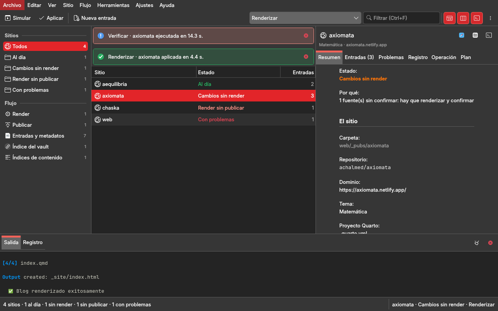
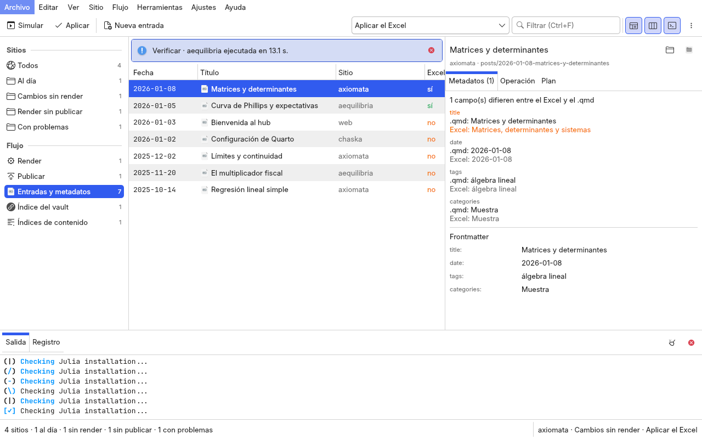
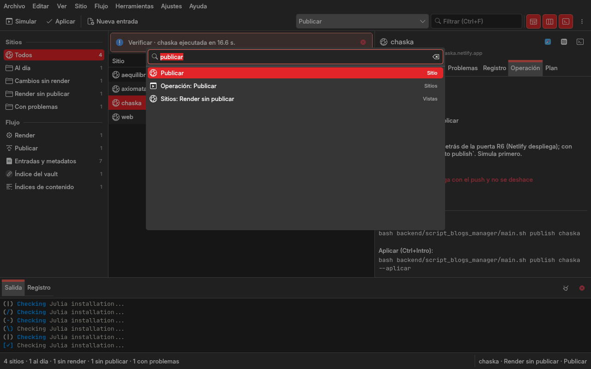

# Rediseño de Quarto Studio: los doce sitios de la familia, sus entradas y el flujo render → publicar en una ventana de trabajo

Fase 5 de la modernización de la familia de studios (`gui-comun/docs/arquitectura-qml-kirigami.md` §8): Quarto Studio
es el sexto que sigue al piloto Git Studio, cuyo lenguaje visual y arquitectura de información
(`git-studio/docs/rediseno.md` §2, §4, §6, §8) el autor aprobó el 2026-11-01 «para todos los programas de la
familia». Biblioteca Studio mostró cómo se aplica a un studio que orquesta suites con datos propios: la tabla de lo
que cada etapa maneja, una operación actual por vista, F5 simula y Ctrl+Intro aplica tras confirmar. Este documento
aplica ese diseño a este studio: la auditoría de lo que hay (§1), las ocho preguntas de producto (§2), la
arquitectura de información (§3), la ventana (§4), lo construido (§5), los componentes (§6), lo que el marco
necesitó (§7) y las decisiones (§8). **Está construido** (rama
`wip/2026-11-02-qml`, 2026-11-02): las capturas de §5 son reales; pasa a `hecho` cuando el autor valide el studio en la
sesión real sobre `web` (`../estado.md`).

Tres reglas condicionan todo lo demás. **Netlify despliega con cada `git push`** (`../CLAUDE.md`, `decisiones.md`
2026-10-06): publicar es irreversible hacia fuera, así que `publish` y `git-commit` simulan siempre primero y se
aplican tras una confirmación que nombra el sitio y su dominio, detrás de la puerta R6 del hub. **El tema de los
doce sitios se comparte por hardlinks** (decisión del autor del 2026-10-08): la ventana no copia, mueve ni reescribe
nada del tema; solo lo renderiza con la CLI. **Un sitio se verifica renderizando** (N 5.16): el estado de un sitio se
lee del disco y de git con la misma regla que la puerta R6 (fecha del último commit de las fuentes frente a la de
index.html de _site), y «Problemas del render» sale de la salida de `quarto render`.

## 1. Auditoría de la GUI actual (Widgets, `gui-comun` 1.1)

Seis páginas en una barra lateral con la marca «Quarto Studio · Blogs y publicaciones» (la carpeta ui,
1.x, retirado en esta fase; se lee en la historia de git), construidas a mano con `gui_comun.widgets` y
`QtWidgets`: tarjetas, cifras, mosaicos, tablas, grupos de botones, consola como cajón, paleta Ctrl+K. La lógica
está separada en `studio/quarto_app/services/` (sin Qt: un `Command` por subcomando de cada backend; `paths.py`
localiza los cinco backends y el hub por `core/env.py`; `project_scanner.py` descubre los sitios por el registro
pubs.yml del hub de el módulo pubs de core y sus entradas; `post_service.py` genera el `index.qmd` de una entrada nueva,
la única lógica portada del asistente de terminal), que esta fase conserva como servicios y amplía con consultas.

| página | qué hace hoy | entidades y operaciones | lógica separada | mezclado en la ventana |
|---|---|---|---|---|
| Inicio | cuatro cifras (sitios, entradas, con git, directorio de trabajo), cinco mosaicos que llevan a las páginas y la lista de las últimas operaciones (`QSettings`) | sitio, operación | `project_scanner` | el recuento, el historial pintado a mano; es un panel de control |
| Blogs | la tabla de sitios (Blog, Posts, Git, `_quarto.yml`, Ruta), diez botones sobre el seleccionado (Render, Preview, Detener preview, Limpiar, Publicar, Verificar, Posts, Git status, Commit+push, Nueva publicación) y cinco por lotes (Render de todos, Limpiar todos, Verificar estructura, Backup de todos, Crear blog…); Publicar y Commit simulan y preguntan con `QMessageBox` | sitio, entrada, corrida | `blog_service`, `post_service` | la confirmación sin mostrar el plan, el estado de cada sitio (nada dice si hay que renderizar o publicar), el diálogo de la entrada nueva (tres pestañas, ~25 campos) |
| Metadata | el Excel (campo y «…»), el blog y el filtro de ruta, «Dry-run» marcado, «Operar sobre el Excel»; seis botones de plantilla y sincronización, seis de tags (con `QInputDialog` para las listas), dos de sincronización desde la ruta | Excel, entrada, tags | `metadata_service` | ninguna tabla de entradas ni del Excel; cada botón corre a ciegas |
| YAML · Índices · Contenido | el directorio o archivo a formatear con «Dry-run»; cuatro botones del índice (sincronizar, detectar rotos, eliminar rotos con pregunta, resumen); el blog, la URL base y la estructura del generador de índices de contenido con Simular y Generar | carpeta, enlace del índice, fragmento `_contenido_*` | `yaml_service`, `index_service`, `similar_service` | nada muestra qué enlaces hay ni cuáles están rotos, ni qué fragmentos existen |

Lo que falta hoy: la ventana **no dice en qué estado está cada sitio** (si sus fuentes cambiaron después del último
render, si hay un render sin publicar, si falta `_quarto.yml` o `_site/`); la salida de `quarto render` se lee en
la consola y se pierde (ningún lugar lista sus errores y avisos con su archivo); las entradas no se ven en ninguna
tabla (ni cuáles están en el Excel); los enlaces del índice del vault y los fragmentos de contenido tampoco; las
confirmaciones no muestran la orden ni el sitio. Preferencias: `ui/tema`, que en 2.x no hace nada, el directorio de
trabajo (que ya da `core/env.py`), el editor, el puerto del preview y el destino de publicación. El lanzador instalado
apunta al Python de Anaconda, que no carga Kirigami; el Python del sistema no trae `openpyxl` ni `pandas`.

## 2. Las ocho preguntas de producto

1. **Tarea principal**: saber de un vistazo cuáles de los trece sitios (el hub y los doce pubs) piden atención
   (fuentes cambiadas sin render, render sin publicar, problemas) y llevarlos al día: renderizar, revisar los
   problemas del render, publicar; de paso, mantener los metadatos de las entradas desde el Excel, el índice del
   vault y los fragmentos de contenido. El sitio es el sujeto; render y publicar, los verbos.
2. **Información constante**: cuántos sitios hay y cuántos piden atención; qué sitio está seleccionado y en qué
   estado; si hay una operación corriendo y en qué sitio va. → la **barra de estado** (recuento a la izquierda; el
   sitio y la operación a la derecha; el progreso en medio) y la **columna Estado** de la tabla.
3. **Acciones más frecuentes**: simular (F5), aplicar (Ctrl+Intro), renderizar el sitio, publicarlo, abrir el
   preview, ver sus entradas, aplicar el Excel. → **la barra**: Simular · Aplicar · la operación de la vista (lista
   desplegable) · el filtro.
4. **Lo que permanece visible**: la tabla de la vista activa y la barra de estado. Navegación, detalles y salida se
   pliegan.
5. **Operaciones contextuales**: sobre un sitio: render, preview, limpiar, verificar, inspeccionar, git status,
   publicar, commit+push, nueva entrada, abrir en Dolphin, terminal, el sitio en el navegador; sobre una entrada:
   abrir el `.qmd`, renderizar esa entrada, abrir su carpeta; sobre un enlace del índice: abrir el destino. → **menú
   contextual, menú Sitio y panel de detalles.**
6. **Solo cuando se pide**: todo lo del sitio (carpeta, repo, dominio, tema, rama, cambios, commits por empujar,
   fechas del último render y del último commit de fuentes); sus entradas; los problemas del último render con su
   archivo y su línea; la salida íntegra de la última corrida; los metadatos de una entrada (su frontmatter y su
   fila del Excel); los enlaces rotos del índice; los fragmentos de contenido. → **panel de detalles** (Resumen ·
   Entradas · Metadatos · Problemas · Registro; Operación y Plan) y las vistas del flujo.
7. **Una sesión completa**: abrir → la barra de estado dice «13 sitios · 2 con cambios sin render · 1 con render sin
   publicar» → Sitios › Sin render: la tabla lista los dos → se elige uno → Resumen dice qué fuentes cambiaron después
   del último render → «Renderizar» en la lista de la barra, F5: el plan dice qué fuentes cambiaron desde el último render y cuándo fue → Ctrl+Intro: `main.sh render axiomata` corre en el panel inferior → al terminar,
   Problemas lista los avisos de Quarto con su archivo, la fila pasa a «Render sin publicar» → «Publicar», F5: la
   simulación de la CLI (puerta R6 y lo que se empujaría) → Ctrl+Intro: el diálogo dice «Publicar axiomata en
   https://axiomata.netlify.app/: Netlify despliega con el push; no se deshace» → Publicar → la fila pasa a «Al día».
8. **Tamaños**: como el piloto (§4.2 de su rediseño): bajo 900 px la navegación se pliega a iconos y los detalles se
   abren como hoja; las columnas secundarias de cada tabla se ocultan al estrecharse.

## 3. Arquitectura de información

### 3.1 Cuatro vistas, un sitio actual, una operación actual, una ventana

Las seis páginas desaparecen como páginas. Hay **cuatro vistas** del centro, elegidas en el panel de navegación en
dos secciones: **Sitios** (la tabla de los trece sitios, con los filtros por estado: Todos · Al día · Con cambios
sin render · Con render sin publicar · Con problemas) y **Flujo** (Render y Publicar, que son la vista Sitios con el
filtro y la operación ya elegidos; Entradas y metadatos; Índice del vault; Índices de contenido). En todas, la fila
elegida fija el **sitio actual** (en Entradas, el sitio de la entrada), sobre el que actúan las operaciones de sitio
y del que hablan los detalles; cada vista tiene **sus operaciones** y la elegida es la **operación actual**, que se
simula con F5 y se aplica con Ctrl+Intro.

| vista | centro (`TablaDatos`) | operaciones (la misma CLI de hoy) | detalles |
|---|---|---|---|
| **Sitios** (filtros: Todos · Al día · Sin render · Sin publicar · Con problemas; Render = Sin render + «Renderizar»; Publicar = Sin publicar + «Publicar») | los sitios del registro de pubs del hub y el hub: Sitio, Estado (color semántico), Entradas, Rama, Cambios (fuentes sin confirmar), ↑ (commits sin empujar), Render (fecha del último index.html de _site confirmado), Tema, Dominio | Renderizar · Preview · Detener preview · Limpiar · Verificar · Inspeccionar · Git status · Publicar · Commit y push · Renderizar una entrada · Renderizar todos · Limpiar todos · Verificar estructura · Respaldar todos · Crear sitio… · Nueva entrada… (diálogo) | **Resumen** (carpeta, repo, dominio, tema, `_quarto.yml`, rama, cambios, por empujar, último render, último commit de fuentes, por qué está en ese estado) · **Entradas** (las del sitio: fecha, título, carpeta) · **Problemas** (n) (los errores y avisos del último render del sitio, con archivo y línea) · **Registro** (la salida íntegra de la última corrida sobre el sitio) · **Operación** · **Plan** |
| **Entradas y metadatos** | todas las entradas de todos los sitios (filtrables por sitio desde la navegación y por texto): Fecha, Título, Sitio, Carpeta, Tags, en el Excel (sí/no) | Plantilla del Excel · Plantilla incremental · Ver diferencias · Aplicar el Excel · Detectar campos nuevos · Crear configuración · Normalizar tags · Reemplazar tags… · Eliminar tags… · Agregar tags… · Estadísticas de tags · Auditoría de tags · Sincronizar fechas · Sincronizar `pdf-url` · Formatear YAML (carpeta) · Formatear YAML (archivo); con el sitio actual como filtro `--blog` y un filtro de ruta | **Metadatos** (el frontmatter de la entrada y su fila del Excel, campo a campo; en qué difieren) · Resumen del sitio · Operación · Plan · Registro |
| **Índice del vault** | los enlaces de `web/_indice/<año>/`: Año, Enlace, Destino, Estado (bien · roto) | Sincronizar el índice · Detectar rotos · Eliminar rotos · Resumen por año | Resumen (el enlace y su destino) · Operación · Plan · Registro |
| **Índices de contenido** | los fragmentos `_contenido_*.qmd` de cada sitio: Sitio, Subblog, Fragmento, Entradas que enlaza, Modificado | Generar los índices del sitio (URL base y estructura como entrada) | Resumen (el fragmento en texto) · Operación · Plan · Registro |

**Inicio** se reparte: las cifras van a la **barra de estado** y a los **contadores de la navegación**; los mosaicos
son las vistas; las últimas operaciones son la pestaña Registro de cada sitio y el Registro del panel inferior.
**Blogs** es la vista Sitios con el estado que hoy no tiene; sus quince botones son operaciones elegidas en la lista
de la barra, el menú Sitio, el menú contextual o la paleta. **Metadata**, **YAML**, **Índices** y **Contenido** son las
vistas del flujo con la tabla de lo que manejan. La ventana gana lo que no tenía: el **estado de cada sitio** por
la regla de la puerta R6, los **problemas del render** con su archivo, el **plan** de cada operación antes de
aplicarla y la confirmación que **nombra el sitio y su dominio** al publicar.

### 3.2 Entidades y dónde vive cada dato

| entidad | datos | dónde |
|---|---|---|
| Sitio (`project_scanner.descubrir_blogs` sobre el módulo pubs de core; `studio/quarto_app/services/sitios.py` para el estado) | carpeta, nombre, repo, dominio, tema; `_quarto.yml`, `.git`, index.html de _site; rama, fuentes sin confirmar (`git status` sobre los pathspecs de fuentes de la puerta R6), commits sin empujar (`rev-list @{u}..HEAD`), fecha del último commit de fuentes y del último de index.html de _site (`git log -1 --format=%ct`), estado derivado | tabla Sitios; detalles › Resumen; contadores de la navegación y de la barra de estado |
| Estado de un sitio | `problemas` (sin `_quarto.yml`, sin git o sin index.html de _site), `sin_render` (fuentes sin confirmar o confirmadas después del último render), `sin_publicar` (`_site/` sin confirmar o commits sin empujar), `al_dia` | columna Estado (negativo · neutro · activo · positivo); filtros; la explicación en Resumen |
| Entrada (`project_scanner.listar_posts`: carpetas `AAAA-MM-DD-*` con `index.qmd`) | fecha, título, carpeta, sitio, tags (frontmatter), si tiene fila en el Excel | tabla Entradas; detalles › Entradas (del sitio) y Metadatos (de la entrada) |
| Excel de metadatos (`backend/script_metadata_manager/excel_databases/quarto_metadata.xlsx`, leído con `openpyxl` del `.venv`) | una fila por entrada (`ruta`, `title`, `date`, `tags`, …) | columna «en el Excel»; detalles › Metadatos (la fila junto al frontmatter) |
| Operación (`studio/quarto_app/services/operaciones.py`: id, título, descripción, la orden de simular y la de aplicar, si pide el sitio, qué entrada pide, qué confirma) | la orden exacta; `simula` (dry-run de la CLI o plan de la ventana), `aplica`; si publica | lista de la barra; menú Sitio y Flujo; detalles › Operación; contexto de la barra de estado |
| Corrida (`gui_comun.tareas.proceso`; una a la vez) | la orden, su salida línea a línea, el código, la duración; en render, el progreso por entrada | panel inferior (Salida); barra de estado; al terminar, el sitio se relee |
| Plan y Registro (caché del studio: por operación y por sitio) | la salida íntegra de la última simulación (Plan) y de la última aplicación (Registro) | detalles › Plan y Registro (`VistaTexto`) |
| Problema del render (`studio/quarto_app/services/render.py`: `ERROR`, `WARN`, `WARNING`, `Error in`, `archivo:línea` de la salida de Quarto) | nivel, mensaje, archivo, línea | detalles › Problemas (`ListaDiagnosticos`); contador en la pestaña; Intro abre el archivo |
| Enlace del índice (`web/_indice/<año>/*`) | año, nombre, destino, roto | tabla Índice del vault |
| Fragmento de contenido (`_contenido_*.qmd` de cada sitio) | sitio, subblog, cuántas entradas enlaza, modificado | tabla Índices de contenido; Resumen (el texto) |
| Preferencias (`QSettings`, las claves de 1.x) | el puerto del preview, el destino de publicación, el Excel, la terminal | «Configurar Quarto Studio…» |

### 3.3 Dónde vive cada operación

Toda operación existe una sola vez, en `Acciones` (`studio/quarto_app/aplicacion.py`), y aparece en los lugares de
la tabla. Las operaciones de las suites son acciones `op.<id>` que **eligen** la operación actual (y llevan a su
vista); correrla es siempre `op.simular` (F5) o `op.aplicar` (Ctrl+Intro).

| operación | menú | barra | contextual | detalles | paleta | atajo |
|---|---|---|---|---|---|---|
| Ir a cada vista (Sitios · Entradas · Índice · Contenido) y a cada filtro | Ver › Vista | | | | ● | Ctrl+1 … Ctrl+4 |
| Elegir una operación | Sitio · Flujo | ● (lista de las de la vista) | ● | | ● | |
| Simular (o Ejecutar, si no escribe) la operación actual | Sitio | ● | | ● (Operación) | ● | F5 |
| Aplicar la operación actual (plan a la vista; publicar y commit confirman con el sitio y su dominio) | Sitio | ● | | ● (Operación) | ● | Ctrl+Intro |
| Cancelar (también detiene el preview) | Sitio | (barra de estado) | | | ● | Esc |
| Nueva entrada… (diálogo con los campos del asistente) · Crear sitio… | Sitio | | ● | | ● | Ctrl+N |
| Abrir en Dolphin · Abrir terminal aquí · Abrir en el navegador (el dominio) · Copiar ruta (del sitio o la entrada actual) | Archivo | | ● | ● (cabecera) | ● | Mayús+F4 · Ctrl+Mayús+C |
| Abrir el `.qmd` de la entrada · Abrir el Excel | Archivo | | ● (Entradas) | ● (Metadatos) | ● | Intro |
| Filtrar · Seleccionar todo | Editar | ● (campo) | | | ● | Ctrl+F · Ctrl+A |
| Releer (los sitios y su estado, las entradas, el índice) | Ver | | ● | | ● | F6 |
| Paneles · pantalla completa | Ver | ● | | | ● | F9 · F11 · F4 · Ctrl+Mayús+F |
| Paleta de órdenes | Herramientas | | | | — | Ctrl+Alt+I · Ctrl+K |
| Instalar el acceso directo · Crear el entorno `.venv` (muestra la orden) | Herramientas | | | | ● | |
| Configurar Quarto Studio… | Ajustes | | | | ● | Ctrl+Mayús+, |
| Manual · Acerca de | Ayuda | | | | ● | F1 |

Reglas: **F5 nunca escribe en un sitio ni en el remoto**: donde la CLI simula (`publish`, `git-commit`,
`--dry-run` de metadatos, YAML, índice y contenido) corre esa simulación; donde no (`render`, `clean`, `backup`,
`init-blog`), la ventana muestra su **plan** (qué sitios y en qué orden, con el motivo; qué se borraría; qué se
crearía) sin correr nada; las que solo leen (`check`, `inspect`, `git-status`, `list-posts`, `check-structure`,
`find-differences`, `tag-stats`, `audit-tags`, `detect-new-fields`, `--check-broken`, `--summary`, `preview`) se
ejecutan con F5 y no tienen Aplicar. **Ctrl+Intro** corre la orden que escribe tras un diálogo con la orden exacta y
lo que toca; publicar y commit+push llevan además el nombre del sitio y su dominio y la advertencia de que Netlify
despliega con el push. **Las operaciones sobre todos los sitios** (render-all, clean-all, backup) muestran la lista
entera en el plan. La paleta ofrece, además de las órdenes, cada sitio («Sitio: …» lo selecciona) y cada operación.

## 4. Distribución de la ventana (1280 × 800)

```text
┌ Sitios — Quarto Studio ─────────────────────────────────────────────────────────────────── (KWin) ┐
│ Archivo  Editar  Ver  Sitio  Flujo  Herramientas  Ajustes  Ayuda                                  │ menú
│ ▶ Simular  ✓ Aplicar │ [Renderizar                    ▾] [Filtrar (Ctrl+F)]             ▯▯▯ ⋯ │ barra
├──────────────┬──────────────────────────────────────────────────────┬───────────────────────────┤
│ SITIOS       │ Sitio          Estado              Entr. Rama Camb ↑ │ axiomata                ▯ ▯ ▯ │
│ ▸ Todos   13 │▌axiomata       ● Cambios sin render  41  main   3  0 │ Matemática · axiomata.netlify.app │
│   Al día   9 │ chaska         ● Render sin publicar 58  main   0  1 │ Resumen Entradas(41) Problemas(2) Registro Operación Plan │
│   Sin render │ web            ● Al día             120  main   0  0 │ Carpeta: web/_pubs/axiomata │
│   Sin publ. 1│ aequilibria    ● Al día              37  main   0  0 │ Estado: fuentes confirmadas el 2026-11-01, │
│   Problemas  │ …                                                    │   después del render del 2026-10-31 │
│ FLUJO        │                                                      │ Último render: 2026-10-31 20:53 │
│   Render   2 │                                                      │ Por empujar: 0            │
│   Publicar 1 │                                                      │                           │
│   Entradas   │                                                      │  [Renderizar] [Publicar…] │
│   Índice     │                                                      │                           │
│   Contenido  │                                                      │                           │
├──────────────┴──────────────────────────────────────────────────────┴───────────────────────────┤
│ Salida │ Registro                                                                       ⌫  ✕     │ panel
│ $ bash backend/script_blogs_manager/main.sh render axiomata                                     │ inferior
│ [ 3/41] posts/2025-06-01-proporcionalidad/index.qmd                                              │ (F4)
├──────────────────────────────────────────────────────────────────────────────────────────────────┤
│ 13 sitios · 9 al día · 2 sin render · 1 sin publicar   Renderizando axiomata · 3 de 41 ▰▰▱   axiomata · Renderizar │
└──────────────────────────────────────────────────────────────────────────────────────────────────┘
```

Proporciones y comportamiento según el tamaño: los del piloto (`git-studio/docs/rediseno.md` §4). La navegación
pide 13 unidades; los detalles, 26; el panel inferior, 9 de alto. Los tres divisores y los paneles se recuerdan en
`QSettings`; la ventana se abre en la vista, el filtro y la operación de la última vez.

## 5. Lo construido

Tres capturas reales (`studio/capturar.py`, 1280 × 800, el Qt del sistema con Kirigami 6.24, sin tocar el escritorio ni
las preferencias) sobre la **familia de sitios de muestra** de `studio/muestra.py`: un hub y tres pubs de juguete con
git y remotos «bare» locales, cada uno en un estado (al día, con cambios sin render, con render sin publicar, con
problemas), un índice del vault con un enlace roto, un fragmento de contenido y un Excel de metadatos, creados en `/tmp`
fuera de la carpeta de inicio con `HOME`, configuración, caché y estado temporales (ninguna ruta de la máquina en
pantalla). Antes de capturar corre de verdad «Verificar» del sitio elegido (`main.sh check`) y, en la oscura, un
`quarto render` real del sitio: la salida del panel inferior es la de la CLI. En Lliphi Oscuro, la vista Sitios con el
Resumen de un sitio recién renderizado y los mensajes de las dos corridas; en Lliphi Claro, la vista Entradas con la
pestaña Metadatos de una entrada (su frontmatter y su fila del Excel, campo a campo); y la paleta de órdenes
filtrando «publicar» sobre la pestaña Operación de Publicar (la orden de simular y la de aplicar, y que Netlify
despliega con el push).

| | |
|---|---|
|  |  |



Qué hay detrás: `studio/quarto_app/aplicacion.py` (el registro de acciones: §3.3 íntegro; Simular se habilita con
operación, sitio si lo pide y sin tarea en curso; Aplicar solo si la operación escribe y, al publicar, si el sitio no
tiene problemas), cinco controladores (`espacio`, `sitios`, `flujo`, `operaciones`, `ajustes`), los servicios de 1.x
intactos (`blog_service`, `metadata_service`, `yaml_service`, `index_service`, `similar_service`, `project_scanner`,
`post_service`, `paths`) más los nuevos sin Qt (`operaciones`: el catálogo con simular, aplicar y plan; `sitios`: el
estado por la regla de la puerta R6; `render`: progreso y problemas de `quarto render`; `datos`: entradas, Excel,
índice, fragmentos), el módulo de filas, y `studio/quarto_app/qml/Main.qml` sobre `VentanaStudio` con nueve
componentes propios (ResumenSitio, EntradasSitio, Problemas, Registro, Metadatos, Elemento, Operacion, Plan, el
diálogo de la entrada nueva y el de ajustes). `tests/run.sh` con 29 pruebas: el catálogo (cada vista tiene
operaciones, simular nunca aplica, lo que publica lo declara), los planes, el estado de cada sitio de la muestra, la
lectura del render, las lecturas de la muestra, las filas, los controladores (tabla y filtros, el sitio y la entrada
actuales, la entrada nueva, el flujo con el Excel, la operación actual y sus órdenes, correr de verdad lo que solo lee
sobre la muestra), un `quarto render` real en `/var/tmp` (Quarto omite los archivos bajo una carpeta oculta), la
ventana entera, cada QML y `--smoke` con el Python del sistema o el `.venv`, y las reglas de la familia. **Ninguna
prueba publica.** Lo que quedó fuera está en `../estado.md` §Por hacer.

## 6. Componentes

| región | componente | función |
|---|---|---|
| Barra de menú · barra de herramientas · barra de estado · paleta · «Acerca de» | `GuiComun.VentanaStudio` | las de la familia; en `herramientasExtra`, la lista de las operaciones de la vista (`QQC2.ComboBox`) y el filtro |
| Navegación | `GuiComun.PanelNavegacion` | Sitios (Todos y los cuatro estados, con su número) y Flujo (Render, Publicar, Entradas y metadatos, Índice del vault, Índices de contenido) |
| Centro | `GuiComun.TablaDatos` (una por vista) sobre `gui_comun.modelos.ModeloTabla` + `ModeloFiltrado` | color semántico solo en Estado; menú contextual con las mismas acciones; Intro abre |
| Detalles | `GuiComun.PanelDetalles` con Resumen (`Kirigami.FormLayout`), Entradas (`TablaDatos`), Metadatos (formulario campo a campo), Problemas (`GuiComun.ListaDiagnosticos`), Registro y Plan (`GuiComun.VistaTexto`), Operación (formulario con lo que pide: `TextField`, `CampoRuta`; Simular y Aplicar al pie) | todo lo del sitio actual, la entrada actual y la operación actual |
| Panel inferior | `GuiComun.PanelInferior` | la salida de la CLI (Salida) y los eventos (Registro) |
| Diálogos | `Kirigami.PromptDialog` (Aplicar; Publicar y Commit con el sitio y su dominio), `Kirigami.Dialog` con `FormCard` (Nueva entrada…: Básico, APA, Resumen; Crear sitio…), `GuiComun.DialogoAjustes` (General) | lo que se pide y se cierra |

## 7. Lo que el marco necesitó (`gui-comun` 2.5.0)

- **`Tareas.proceso(entrada=, entorno=)`**: la entrada estándar del proceso (las respuestas a las confirmaciones de un
  guion que la ventana ya confirmó: el respaldo, `clean-all`, `--clean-broken`) y variables de entorno; sin `entrada`,
  la entrada está cerrada y un guion que pregunta no se cuelga.
- **La consola limpia las secuencias ANSI** de la salida de un proceso: el gestor de blogs colorea su salida y el panel
  inferior la mostraba con los códigos.

Nada de `widgets/` se toca. La versión subió a 2.5.0 con CHANGELOG, la referencia de componentes y dos pruebas; la
etiqueta `v2.5.0` queda local hasta el visto bueno del autor (rama `wip/2026-11-02-qml-quarto`).

## 8. Decisiones

| id | decisión | por qué |
|---|---|---|
| Q1 | Cuatro vistas (Sitios con filtros por estado, Entradas y metadatos, Índice del vault, Índices de contenido) y un sitio actual, en lugar de seis páginas de botones | el diseño aprobado de la familia: se opera viendo el objeto (qué sitio pide render o publicación, qué entradas hay) |
| Q2 | El estado de un sitio se calcula con la regla de la puerta R6 (fecha del último commit de las fuentes frente a la del último index.html de _site confirmado) más `git status` de las fuentes y `rev-list @{u}..HEAD` | es la regla que decide si un push pasa; así la ventana dice lo mismo que la puerta antes de intentar publicar |
| Q3 | F5 simula: la simulación de la CLI donde la hay (`publish`, `git-commit`, `--dry-run`), y el plan de la ventana donde no (render, clean, backup, init-blog: qué sitios, en qué orden, por qué, qué se borraría); Ctrl+Intro aplica tras un diálogo con la orden exacta | regla 3 del workspace; `render` y `clean` de la CLI no simulan y la ventana no los modifica |
| Q4 | Publicar y commit+push confirman nombrando el sitio y su dominio, con la advertencia de que Netlify despliega con el push y no se deshace; nunca sobre todos los sitios a la vez | publicar es irreversible hacia fuera (`decisiones.md` 2026-10-06); una confirmación por sitio |
| Q5 | Los problemas del render salen de la salida de `quarto render` (ERROR, WARN, `archivo:línea`) guardada por sitio en la caché del studio | un sitio se verifica renderizando (N 5.16); la CLI no deja registro y la consola lo perdía |
| Q6 | El tema compartido por hardlinks no se toca: la ventana no copia ni reescribe nada de `assets/`, `_extensions/`, `_partials/` | decisión del autor del 2026-10-08; romper un hardlink desincroniza los doce sitios |
| Q7 | Las dependencias que el Python del sistema no trae (`openpyxl`, `pandas`) viven en `.venv/` del repo, creado con `/usr/bin/python3 -m venv --system-site-packages` (ve el PySide6 y el Kirigami del sistema) y `pip install openpyxl pandas pyyaml`; `main.py` se relanza con él si existe y, si no, avisa qué crear; los backends de Python corren con ese intérprete; nunca se instala PySide6 en el `.venv` | el Qt del sistema es el que trae Kirigami; `requirements.txt` deja de pinear PySide6 |
| Q8 | La entrada nueva se crea con `post_service` desde un diálogo QML con los mismos campos del asistente de terminal (Básico, APA, Resumen) | el asistente de 50 preguntas no se automatiza; es la única lógica portada y se conserva |
| Q9 | Plan y registro por operación y por sitio en la caché del studio | hoy la salida se pierde al correr otra cosa |
| Q10 | Las pruebas y las capturas corren sobre una familia de sitios de muestra en un temporal (hub con registro, tres pubs con git y remoto bare local, `_indice/`, un fragmento, un Excel; `quarto render` real de un `.qmd` mínimo si `quarto` está, si no se salta); nunca `web` ni los pubs reales; nunca publicando | «Netlify despliega con cada push» (`../estado.md`); repo público: ninguna ruta de la máquina en las capturas |
| Q11 | Lo sensible solo por estructura: la ventana lista los sitios del registro, sus entradas y los enlaces del índice (lo que las CLI ya listan); no muestra el contenido de las entradas, solo su frontmatter y su fila del Excel | regla 8 del workspace |
