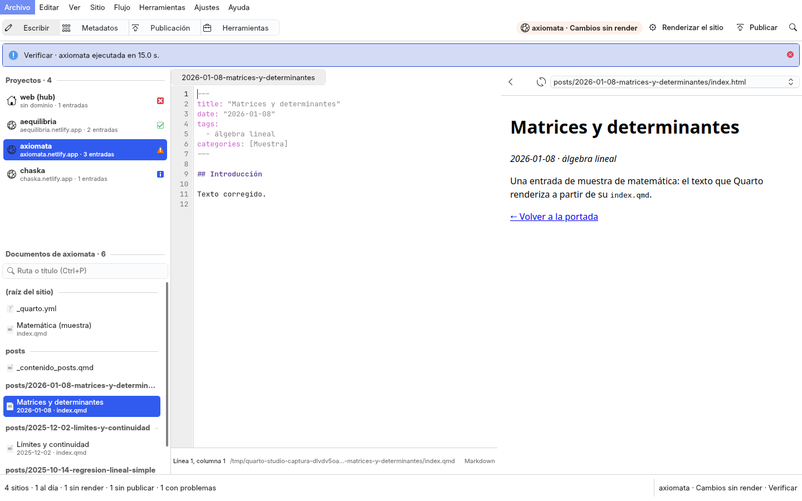

# Reingeniería de Quarto Studio: diagnóstico, distribución y decisiones

Encargo del autor del 2026-11-02 (§3.7 de la instrucción maestra de la reingeniería de los diez studios): Quarto Studio
debe sentirse como un entorno de desarrollo y publicación de sitios (RStudio con Quarto, VS Code con Quarto): panel de
proyectos, archivos y documentos, editor Markdown y Quarto, vista previa, navegación entre páginas, diagnóstico de
metadatos, renderizado e historial de publicaciones; y una vista de publicación que diga con claridad el proyecto, el
dominio de destino, los archivos que cambiarán, la última publicación y el estado de construcción, que compruebe que el
destino corresponde al sitio elegido y que no publique por accidente en otro dominio. Este documento es el diagnóstico de
la ventana 2.0 (`rediseno.md`), la distribución nueva y sus decisiones (E1–E12). Lo construido, cómo se verificó y lo que
quedó fuera, en §4 y §5.

## 1. Diagnóstico de la ventana 2.0 (leído en el código, `respaldo/antes-reingenieria-2026-11-02`)

Capturas de antes: `docs/figuras/antes/quarto-studio-{oscuro,claro,paleta}.png`.

### 1.1 Qué hace cada pieza hoy

| pieza | dónde | qué hace de verdad |
|---|---|---|
| los sitios | `studio/quarto_app/services/sitios.py`, `studio/quarto_app/controladores/sitios.py` | el hub y los pubs del registro (`pubs.yml` de `_pubs` en el hub) con su estado por la regla de la puerta R6 (fuentes frente a `_site/`, sin confirmar, sin empujar). **Correcto** |
| las entradas y el Excel | `studio/quarto_app/services/datos.py`, `studio/quarto_app/controladores/flujo.py` | cada `index.qmd` con su frontmatter frente a su fila del Excel, campo a campo. **Correcto**, pero solo para la entrada elegida: no hay un diagnóstico de todo el sitio |
| las operaciones | `studio/quarto_app/services/operaciones.py`, `studio/quarto_app/controladores/operaciones.py` | cada una es la CLI de un backend (F5 simula o muestra el plan, Ctrl+Intro aplica tras confirmar); publicar y commit+push nombran el sitio y su dominio. **Correcto** |
| los problemas del render | `studio/quarto_app/services/render.py` | errores y avisos de `quarto render` con su archivo. Correcto |
| la distribución | `studio/quarto_app/qml/Main.qml` sobre `VentanaStudio` | navegación · cuatro tablas (sitios, entradas, índice, fragmentos) · detalles en seis pestañas · consola |

### 1.2 Lo incompleto y lo que no se comporta

- **No se escribe**: no hay editor; abrir un `.qmd` es `xdg-open`. Ni árbol de documentos del sitio ni navegación entre páginas.
- **No se ve el sitio**: ninguna vista previa (ni el `_site` renderizado ni el Markdown); «Preview» lanza el servidor de
  Quarto, que hay que abrir en el navegador.
- **Publicar es una fila más de la lista de operaciones**: el diálogo nombra sitio y dominio, pero no muestra qué archivos
  cambian, cuándo fue la última publicación ni si el destino corresponde de verdad al sitio (el `site-url` de su
  `_quarto.yml`, su remoto git); no hay historial de publicaciones.
- **El diagnóstico de metadatos es de una entrada**: no se ve qué entradas difieren del Excel en todo el sitio.
- **Atajos**: F5 sirve para todo; el render no tiene el Ctrl+Mayús+K de RStudio.
- **KDE**: abrir la carpeta y el archivo con `xdg-open`; con `gui-comun` 3.0, `escritorio`.

### 1.3 Riesgos

| riesgo | mitigación |
|---|---|
| publicar en otro dominio | la vista de publicación compara el dominio del registro, el `site-url` del `_quarto.yml` y el remoto git con el repositorio del registro; si algo no coincide, Publicar se deshabilita y dice qué; la confirmación nombra sitio y dominio |
| el editor pisa un cambio externo | el controlador del editor de LaTeX Studio (guardar sin pisar un cambio en disco, vigilante de archivos) |
| tocar `web` o los pubs en las pruebas | la familia de muestra (`studio/muestra.py`); ninguna prueba publica; el historial y la vista de publicación solo leen git |
| romper el tema de los 12 sitios (hardlinks) | el editor no escribe en el tema y la ventana no copia archivos: guardar escribe sobre el mismo inodo (`write_text` abre el archivo existente) |
| QtWebEngine ausente | la vista previa carga el componente web con un `Loader`; sin el módulo, el Markdown en `VistaTexto` |

## 2. Referencias y distribución

| referencia | qué se toma |
|---|---|
| **RStudio con Quarto** | proyectos y archivos a la izquierda, el editor con su vista previa al lado, Ctrl+Mayús+K para renderizar |
| **VS Code con Quarto** | el árbol del proyecto, pestañas de archivos, la vista previa que sigue al documento |
| **Netlify, GitHub Pages** | la página de despliegue: destino, qué cambia, último despliegue, historial |

```
┌ Escribir · Metadatos · Publicación · Herramientas │ sitio · estado │ Renderizar (Ctrl+Mayús+K) ┐
│ Proyectos (hub y pubs,  │ pestañas de archivos                 │ vista previa: _site/…html  │
│ con su estado)          │ editor Markdown/Quarto con números,  │ (QtWebEngine) o el Markdown│
│ Documentos del sitio    │ buscar y reemplazar                  │ atrás · adelante · páginas │
└ barra de estado ─────────────────────────────────────────────────────────────────────────┘
```

## 3. Decisiones

- **E1. `VentanaBase` con cuatro áreas** (Ctrl+1–4): Escribir (la principal), Metadatos, Publicación y Herramientas (las
  operaciones de 2.0, el índice del vault y los índices de contenido). Los proyectos a la izquierda en todas.
- **E2. Proyectos**: el hub y los pubs del registro con su estado R6 (el de 2.0) y su dominio.
- **E3. Documentos del sitio**: los `.qmd`, `.md`, `.yml`, `.bib`, `.scss`, `.css`, `.lua` del proyecto por carpetas (sin
  `_site`, `_freeze`, `.quarto`, `_pubs`), las entradas con su título y su fecha; filtrables.
- **E4. Editor** (el de LaTeX Studio, copiado y adaptado; candidato a `gui-comun`): pestañas, `TextArea` con
  KSyntaxHighlighting (Markdown para `.qmd` y `.md`, YAML, BibTeX, SCSS), números de línea, buscar y reemplazar, guardar
  sin pisar un cambio externo. Ctrl+S guarda; la ventana no escribe nada más del sitio.
- **E5. Vista previa**: la página renderizada que corresponde al documento (`_site/<ruta>.html`), con QtWebEngine del
  sistema, con atrás, adelante, recargar y la lista de páginas del sitio para navegar; sin `_site` o sin el módulo, el
  Markdown del documento en `VistaTexto`. Se recarga al terminar un render.
- **E6. Renderizar (Ctrl+Mayús+K)**: el sitio entero o el documento abierto, por el gestor de blogs (la CLI de 2.0).
- **E7. Diagnóstico de metadatos**: todas las entradas del sitio con cuántos campos difieren del Excel, las que faltan en
  él y las del Excel sin documento; la comparación campo a campo de la elegida. Nada se sobrescribe: aplicar el Excel
  sigue siendo una operación que simula primero.
- **E8. La vista de publicación**: proyecto, dominio de destino, estado de construcción (R6), archivos que cambiarán
  (sin confirmar y commits por empujar, con sus archivos), última publicación (el último commit del remoto que tocó
  `_site/`) y las comprobaciones del destino.
- **E9. El destino corresponde al sitio**: el dominio del registro de pubs, el `site-url` del `_quarto.yml` y el remoto
  `origin` frente al repositorio del registro tienen que coincidir; si no, Publicar no se ofrece y la vista dice cuál falla.
  La confirmación nombra el sitio y el dominio (estado de operación «publicación»).
- **E10. Historial de publicaciones**: los commits del remoto que tocaron `_site/` (fecha, mensaje, archivos), leídos de git.
- **E11. KDE**: abrir y mostrar en Dolphin con `escritorio` de la base; estados de operación en las acciones.
- **E12. Atajos de RStudio**: Ctrl+Mayús+K renderizar, Ctrl+S guardar, Ctrl+F buscar en el documento, Ctrl+P ir a un
  documento, Ctrl+1–4 las áreas, F5 simular la operación, Ctrl+Intro aplicar tras confirmar, Ctrl+K la paleta.

## 4. Lo construido y cómo se verificó



| pieza | dónde |
|---|---|
| la ventana y las áreas (E1, E11, E12) | `studio/quarto_app/qml/Main.qml` sobre `VentanaBase`; `studio/quarto_app/controladores/espacio.py`; `studio/quarto_app/aplicacion.py` (Ctrl+1–4, Ctrl+Mayús+K, Ctrl+S, Ctrl+P, F7, `escritorio`, estados de operación) |
| proyectos (E2) | `Sitios.proyectos` (`studio/quarto_app/controladores/sitios.py`); `studio/quarto_app/qml/componentes/PanelProyectos.qml` |
| documentos (E3) | `studio/quarto_app/services/documentos.py`, `studio/quarto_app/controladores/documentos.py` |
| editor (E4) | `EspacioEscritura.qml` con `EditorTexto` y `BarraBuscarReemplazar` de `gui-comun` 3.1 y `gui_comun.editor.ControladorEditor` (2026-11-03; antes, copias de LaTeX Studio: su controlador, su editor, su barra de búsqueda y su resaltado) |
| vista previa (E5) | `studio/quarto_app/qml/componentes/VistaPrevia.qml` y `VistaWeb.qml` (QtWebEngine en un `Loader`) |
| renderizar (E6) | la acción `sitio.renderizar` sobre la operación `render` de siempre |
| metadatos (E7) | `datos.diagnostico`; `studio/quarto_app/controladores/metadatos.py`; `EspacioMetadatos.qml` |
| publicación (E8–E10) | `studio/quarto_app/services/publicacion.py`, `studio/quarto_app/controladores/publicacion.py` (la guarda `motivoDestino` que consulta `Operaciones`), `EspacioPublicacion.qml`, la acción `sitio.publicar` (estado «publicación») |

Verificación (2026-11-02, rama `wip/2026-11-02-reingenieria`):

- `tests/run.sh`: 46 pruebas sobre la familia de muestra (las 28 de antes, adaptadas, y los documentos y su página, el
  destino con un `site-url` ajeno, otro repositorio o sin dominio, lo que va al push, el historial, el diagnóstico, la
  vista previa, el editor que guarda en el mismo inodo con un hardlink y no pisa un cambio externo, la guarda que
  bloquea publicar y empujar pero no renderizar, la ventana entera y cada QML con un proyecto y un documento abiertos).
  Ninguna publica; el render real sigue en `/var/tmp`.
- Las pruebas de los backends (`tests` sin `tests/studio`): en verde salvo `test_fuentes_iguales_a_las_de_la_puerta`,
  que falla igual en `main` (`estado.md` §Por hacer, 2026-10-27). Recoger `tests/` entero choca por los dos `conftest.py`
  (también en `main`).
- Capturas sobre la muestra: `docs/figuras/quarto-studio-{claro,oscuro,publicacion,metadatos,herramientas,paleta}.png`;
  las de antes, en `docs/figuras/antes/`. La vista previa con QtWebEngine se ve en ellas.

## 5. Lo que quedó fuera

- **Renderizar solo el documento abierto**: Ctrl+Mayús+K renderiza el sitio; «Renderizar la entrada» sigue en Herramientas.
- **Autocompletado de Quarto** (atajos ``, referencias cruzadas `@fig-`): el editor no completa.
- **El editor y la vista previa en `gui-comun`**: copiados de LaTeX Studio; promoverlos es del carril A.
- **Comprobar el destino contra Netlify**: las comprobaciones son locales (registro, `_quarto.yml`, git).
