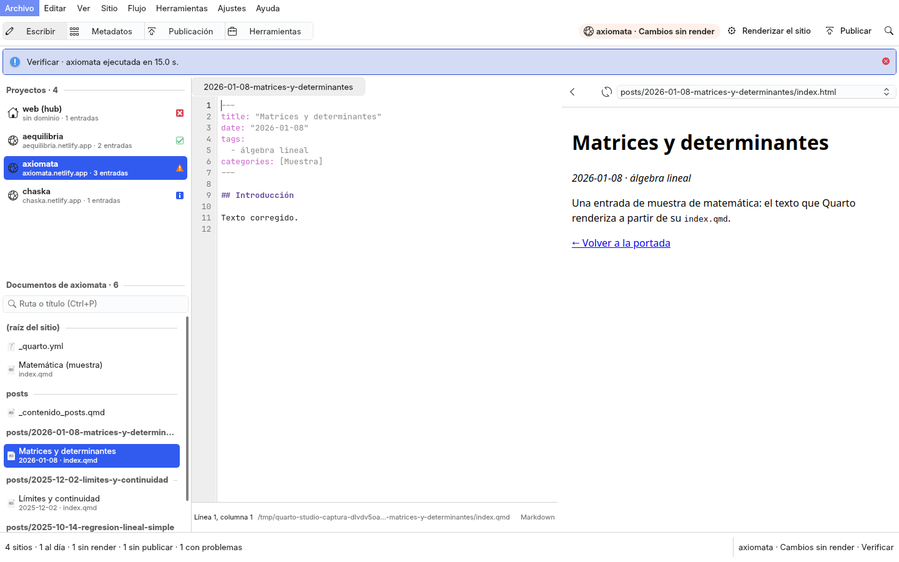
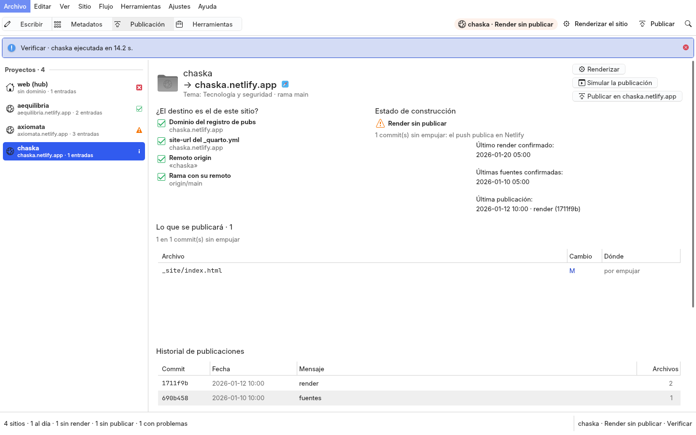

# studio/ — Quarto Studio, el entorno de escritura y publicación (QML + Kirigami sobre gui-comun 3.0) de la familia de blogs
<!-- suite:inicio -->
**Suite `quarto_studio`** · objetivo *publicacion* · estado *activo* · python · interfaz gui

Entorno de escritura y publicación de la familia de sitios Quarto (QML + Kirigami sobre gui-comun 3.0): los proyectos con su estado de construcción por la regla de la puerta R6, los documentos del sitio, el editor Markdown y Quarto con la vista previa del _site renderizado, el diagnóstico del Excel frente a los .qmd sin sobrescribir nada, el renderizado (Ctrl+Mayús+K) y la vista de publicación (destino comprobado, archivos que cambiarán, última publicación, historial); las operaciones de siempre son la CLI de un backend.

- Escribe en: web, vault · simula por defecto: sí
- Depende de: /usr/bin/python3 con PySide6 del sistema (python3-pyside6.*) y Kirigami (qml6-module-org-kde-kirigami), {'gui-comun 3.0 (módulo QML GuiComun': 'VentanaBase, escritorio, estados de operación)'}, {'qml6-module-qtwebengine para la vista previa (opcional': 'sin él, el Markdown)'}, .venv del repo con openpyxl, pandas y pyyaml para los backends de metadatos (requirements.txt; opcional), blogs_manager, metadata_manager, pub_index_symlink, format_yaml, generador_publicacion_similar
- Nota: No renderiza ni publica por su cuenta: corre la CLI de cada backend; publicar y commit+push simulan primero, se aplican tras confirmar con el sitio y su dominio (Netlify despliega con el push) y no se ofrecen si el dominio del registro, el site-url del _quarto.yml o el remoto no corresponden al sitio. El editor escribe solo con Ctrl+S, en el mismo archivo (conserva los hardlinks del tema).

Comandos:

```bash
main.py
main.py --smoke
../install.sh
```

<sub>Bloque generado desde `suite.yml` por `core/suites.py generar` (2026-11-02); no se edita a mano.</sub>
<!-- suite:fin -->

## Qué es

Un entorno de escritura y publicación de sitios Quarto, al modo de RStudio y VS Code con Quarto
([../docs/reingenieria.md](../docs/reingenieria.md)), en `VentanaBase` de `gui-comun` 3.0. A la izquierda, siempre, los
**proyectos** (el hub y los pubs del registro, con su estado de construcción por la regla de la puerta R6 y su dominio);
en el centro, cuatro áreas (Ctrl+1–4):



- **Escribir**: los documentos del proyecto por carpetas (las entradas con su título y su fecha; Ctrl+P busca uno), el
  editor Markdown y Quarto en pestañas (KSyntaxHighlighting, números de línea, buscar y reemplazar, Ctrl+S guarda sin
  pisar un cambio hecho fuera) y la **vista previa** (F7): la página del documento en `_site/`, en QtWebEngine del
  sistema, con atrás, adelante y las páginas del sitio para navegar; desde una página se edita su documento. Sin
  `_site` o sin QtWebEngine, el Markdown. **Ctrl+Mayús+K renderiza** el sitio y la vista previa se recarga.
- **Metadatos**: el Excel frente a los `.qmd` de todas las entradas del sitio (las que difieren, las que no tienen fila,
  las filas sin documento) y, de la elegida, campo a campo. Nada se sobrescribe: «Llevar el Excel a los documentos…» es
  la operación de siempre, que muestra la orden y confirma.
- **Publicación**: el proyecto y su **dominio de destino**, las **comprobaciones de que el destino es el del sitio** (el
  dominio del registro, el `site-url` del `_quarto.yml`, el remoto `origin` frente al repositorio del registro, la rama
  con su remoto), el estado de construcción, **los archivos que cambiarán**, la **última publicación**, el **historial**
  (los commits del remoto que tocaron `_site/`) y la salida de la última corrida. Publicar confirma con la base nombrando
  el sitio, el dominio y cuántos archivos van, y **no se ofrece si el destino no corresponde** (tampoco «Commit y push»).
- **Herramientas**: las vistas de 2.0 (sitios, entradas y metadatos, índice del vault, índices de contenido) con sus
  operaciones: F5 simula (la CLI o el plan de la ventana), Ctrl+Intro aplica tras confirmar.



**La ventana no renderiza ni publica por su cuenta**: cada operación es la CLI de su backend. El editor escribe solo con
Ctrl+S y en el mismo archivo, así que los hardlinks del tema compartido de los 12 sitios no se rompen.

## El entorno del studio

La ventana corre con el Python del sistema (`/usr/bin/python3`), cuyo Qt es el que trae Kirigami. Los backends de
metadatos necesitan `openpyxl` y `pandas`, que el sistema no trae: viven en `.venv/` del repo, creado sobre el Python
del sistema para que vea su PySide6 (rediseño Q7), y `main.py` se relanza con él si existe:

```bash
/usr/bin/python3 -m venv --system-site-packages .venv && .venv/bin/pip install -r requirements.txt   # sin sudo ni apt
```

Sin el `.venv`, la ventana avisa qué crear (también Herramientas › El entorno del studio…), la columna «Excel» y la
pestaña Metadatos quedan vacías y las operaciones de metadatos fallan con el mensaje del backend. PySide6 no se
instala en el `.venv`: el de pip no carga Kirigami.

## Estructura

| archivo | qué es |
|---|---|
| `main.py` | el punto de entrada, sin lógica (`/usr/bin/python3`; se relanza con `.venv/bin/python` si existe) |
| `quarto_app/aplicacion.py` | arma la aplicación: controladores, el registro de acciones (menú, paleta, atajos, estados de operación) y `quarto_app/qml/Main.qml`; fija `AA_ShareOpenGLContexts` para QtWebEngine |
| `quarto_app/controladores/` | `espacio` (áreas, vista, barra de estado), `sitios` (los proyectos con su estado, el sitio actual), `documentos` (los del sitio, la página de la vista previa), `editor` (el de LaTeX Studio adaptado), `metadatos` (el diagnóstico), `publicacion` (destino, archivos, historial; la guarda de publicar), `flujo`, `operaciones`, `ajustes` |
| `quarto_app/services/` | sin Qt: `documentos`, `publicacion`, `sitios` (la regla R6), `datos` (entradas, Excel, `diagnostico`), `operaciones` (el catálogo), `render`, los `*_service.py` de cada backend, `project_scanner`, `post_service`, `paths` |
| `quarto_app/qml/` | `Main.qml` sobre `GuiComun.VentanaBase` y `componentes/` (PanelProyectos, EspacioEscritura, EditorArchivo, BarraBusqueda, VistaPrevia, VistaWeb, EspacioMetadatos, EspacioPublicacion, EspacioHerramientas y los de 2.0) |
| `muestra.py` | la familia de sitios de muestra (un hub y tres pubs con git y remotos bare, cada uno en un estado, con páginas renderizadas; un Excel); nunca `web` ni los pubs |
| `capturar.py` | las capturas de la documentación sobre la muestra, con `HOME` temporal fuera de la carpeta de inicio |

## Uso

```bash
/usr/bin/python3 studio/main.py                      # desde quarto-studio/, en la sesión real (se relanza con .venv si existe)
QT_QPA_PLATFORM=offscreen /usr/bin/python3 studio/main.py --smoke     # construye la interfaz y sale
./install.sh                                         # acceso directo en el menú (con -n, simula)
/usr/bin/python3 studio/capturar.py docs/figuras/quarto-studio-oscuro.png --esquema <LliphiOscuro.colors> --sitio aequilibria --documento phillips
/usr/bin/python3 studio/capturar.py salida.png --area publicacion --sitio chaska
tests/run.sh                                         # desde quarto-studio/: la muestra en un temporal, cada QML y --smoke; nada publica
```

## Límite honesto

- **El estado se lee de git y del disco cada vez** (F6 relee): lo que se renderice o publique desde la terminal se refleja igual.
- **La vista previa muestra el `_site` como está**: un documento sin renderizar enseña la portada (lo dice); Ctrl+Mayús+K
  renderiza el sitio entero, no solo el documento.
- **QtWebEngine carga las páginas locales con lo que ellas pidan** (fuentes o MathJax de una CDN): sin red, algo puede faltar.
- **Las comprobaciones del destino son las que se pueden hacer sin red**: el registro, el `_quarto.yml` y git; no
  consultan Netlify.
- **Los problemas del render salen de la salida de Quarto** (ERROR, WARN, `archivo:línea`): un error que Quarto no anuncie así no aparece.
